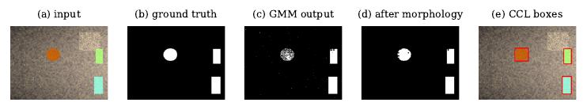
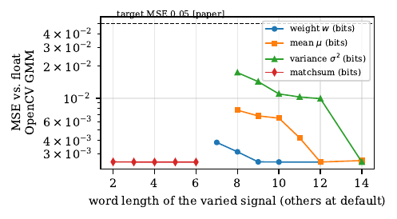
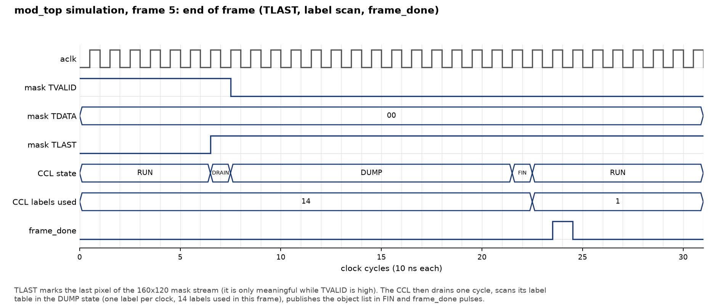

# FPGA-Based Real-Time Moving Object Detection on Zynq

Gaussian mixture model (GMM) background subtraction, 3×3 morphology and single-pass connected component labeling (CCL) in the programmable logic of a Zynq-7000. The GMM follows the hardware-oriented OpenCV formulation of Genovese and Napoli. The design runs on a PYNQ-Z2 at 100 MHz and finds moving objects in VGA video.



## Results

| | Value |
|---|---|
| Detector core | 3.8k LUTs, 7.2 % of the XC7Z020 (post-route, Vivado 2025.2) |
| Clock | 100 MHz, worst negative slack +0.193 ns |
| Datapath | 1 pixel per clock, 309,778 clocks (3.10 ms) per 640×480 frame in simulation |
| Hardware path on the board (PYNQ-Z2) | 8.71 ms per VGA frame, 114.8 fps (measured over 300 frames) |
| End to end with Python video decoding | 34.9 fps |
| ARM-only OpenCV MOG2 + morphology + CCL | 7.4 fps (135.4 ms per frame) |
| Speed-up over ARM | 15.5× (hardware path), 4.7× (end to end) |
| Board vs. model | bit-exact on the first 20 frames |
| Accuracy (synthetic sequence, 126-bit model) | 0.25 % pixel mismatch vs. float OpenCV GMM, F1 0.984 |
| Estimated power | 43 mW for the core, 1.26 W for the processing system (Vivado, vectorless) |

The hardware path is limited by memory: every frame moves 4.9 MB of model in each direction through one 64-bit HP port, about 70 % of its peak bandwidth.

## Main finding: pixel accuracy is not enough

The base paper stores 99 bits per pixel and judges word lengths by the fraction of pixels that differ from a double-precision run. That 99-bit model passes the paper's target (0.033 < 0.05). After blob analysis it still gives 14.8 false boxes per frame and an F1 of 0.749. A 126-bit model fits the same 128-bit DMA word. It differs from the floating-point algorithm in only 0.25 % of the pixels and reaches F1 0.984. Both word-length sets are synthesis parameters here (`wide` and `paper`).



## What is in the design

```
RGB -> Y -> GMM (K=3, 5-stage pipeline) -> 3x3 closing/opening -> single-pass CCL -> boxes + areas
            ^                 |
            GMM model (126 or 99 bits per pixel) in DDR, read and written back every frame by AXI DMA
```

* Five-stage GMM pipeline with power-of-two learning rates, comparator-based rate look-up and a software warm-up schedule.
* Four streaming 3×3 morphology stages (dilate, erode, erode, dilate), enabled in pairs.
* Two-stage single-pass CCL with a fully resolved merger table. It outputs bounding boxes and areas and never stores a labeled image. The CCL was split into two stages to go from about 67 MHz to 100 MHz.
* Two AXI DMAs (model, and pixels + mask) and an AXI4-Lite register file. PYNQ Python driver and a bare-metal C application.
* A bit-exact Python model, a self-checking testbench with random stalls, and a 400-image random CCL test.

## Repository layout

| Folder | Contents |
|---|---|
| `rtl/` | Verilog sources: `mod_top.v`, `gmm_core.v`, `morph_chain.v`, `bin_morph3x3.v`, `ccl_single_pass.v`, `axis_skid.v`, `mod_axil_regs.v` |
| `sim/` | Self-checking testbench, CCL test, test vectors, run scripts |
| `model/` | Bit-exact Python model, synthetic scene, vector generator |
| `eval/` | Float references, accuracy and word-length study, result figures |
| `sw/pynq/`, `sw/baremetal/` | PYNQ driver and demo, bare-metal Vitis application |
| `vivado/` | Tcl script that builds the block design and bitstream |
| `syn/` | Yosys scripts and early resource estimates |
| `board/` | Prebuilt PYNQ-Z2 overlay (`mod_overlay.bit`, `.hwh`) |
| `docs/` | Report, simulation waveforms, full build and run guide |

## Quick start

Simulate (no Vivado project needed, test vectors are included):

```bash
cd sim
./run_sim.sh          # Icarus Verilog; ends with TEST PASSED
./run_xsim.sh         # Vivado simulator, after sourcing settings64.sh
```

Build the bitstream (Vivado 2020.2 or newer, board files installed):

```bash
cd vivado
vivado -mode batch -source create_project.tcl -tclargs pynq-z2 100 1 wide
```

Run on a PYNQ board: copy `board/mod_overlay.*` and `sw/pynq/*` to the board, add a video such as OpenCV's `vtest.avi`, then:

```bash
sudo python3 run_demo.py --video vtest.avi --frames 300 --out result.avi
sudo python3 run_demo.py --video vtest.avi --verify 20      # hardware vs. model
sudo python3 run_demo.py --video vtest.avi --swbench 100    # ARM-only baseline
```

The full guide, including the register map, is in [docs/BUILD_AND_RUN.md](docs/BUILD_AND_RUN.md).

## Simulation waveforms

[docs/waveforms/](docs/waveforms/) has timing diagrams from the testbench (pipeline fill, mask stream, end of frame, random stalls) and the Vivado simulator logs.



## Report

The IEEE-format technical report is in [docs/report/](docs/report/) (`report.pdf` and the LaTeX source).

## Limits

* At most 127 provisional labels per frame (a status flag reports overflow) and 32 reported objects.
* Rows up to 1024 pixels wide.
* With the 126-bit model, learning rates below 2⁻⁷ lose small updates.
* `samples_data_vtest.avi` is not included. Use OpenCV's `samples/data/vtest.avi`.

## Base paper

M. Genovese and E. Napoli, "ASIC and FPGA Implementation of the Gaussian Mixture Model Algorithm for Real-Time Segmentation of High Definition Video," *IEEE Trans. VLSI Syst.*, vol. 22, no. 3, pp. 537–547, 2014. https://ieeexplore.ieee.org/document/6481463
